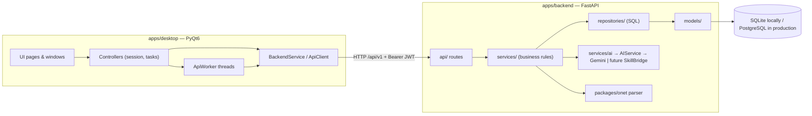

# SkillBridge AI

A Windows desktop application (PyQt6) and FastAPI backend for career exploration, skill-gap analysis, learning roadmaps, portfolio feedback, project ideas, opportunity discovery, progress analytics, and moderated community knowledge — built on official O*NET occupational data, with a provider-independent AI layer and a consent-based path toward a future SkillBridge model.

## Architecture



UI shows and collects; controllers coordinate background work and session state; services hold business rules and transactions; repositories hold SQL; the API layer validates and maps results to HTTP. Every AI feature goes through one `AIService`, so providers can be swapped by configuration. Full details: [docs/architecture/overview.md](docs/architecture/overview.md).

## Repository structure

```
apps/backend/     FastAPI app: api/ (routes, dependencies, middleware), core/ (config, security, logging,
                  exceptions), database/ (engine, session, migrations), models/, schemas/, repositories/,
                  services/ (ai, authentication, careers, skills, roadmaps, portfolio, projects,
                  opportunities, community, training, analytics), cli/ (create_admin, load_onet)
apps/desktop/     PyQt6 app: application.py, config/, controllers/, services/, workers/,
                  ui/ (windows, pages, components, dialogs, styles)
packages/onet/    Framework-free O*NET archive parsing and validation
scripts/          launch_local.py — migrate + API + desktop on one loopback port
tests/            unit/, integration/, end_to_end/, fixtures/, conftest.py
docs/             architecture/, api/, database/, deployment/, development/
infrastructure/   docker/Dockerfile
data/onet/raw/    Drop folder for downloaded O*NET archives (ignored by Git)
```

## Technology stack

Python 3.12 · FastAPI · SQLAlchemy 2 · Alembic · Pydantic 2 · PyJWT + Argon2 · httpx · Pillow · PyQt6 · matplotlib · SQLite (local) / PostgreSQL via psycopg (production) · pytest · Pyright · Docker / Railway.

## Installation (Windows)

```powershell
git clone https://github.com/Kiwmoj/SkillBridgeAI.git
cd SkillBridgeAI
py -3.12 -m venv .venv
.\.venv\Scripts\python.exe -m pip install -r requirements.txt
```

Use Python **3.12** (the version the project is tested on). In VS Code, open the repository folder and select `.venv\Scripts\python.exe` as the interpreter.

## Environment configuration

All backend settings are read once by [`apps/backend/core/config.py`](apps/backend/core/config.py) from environment variables or a `.env` file (copy [`.env.example`](.env.example)), validated, and shared by every module. Invalid values stop startup with a clear message.

| Variable | Default | Notes |
| --- | --- | --- |
| `APP_ENV` | `development` | `production` requires PostgreSQL, a `JWT_SECRET`, and HTTPS origins/URLs |
| `DATABASE_URL` | `sqlite:///./skillbridge.db` | `postgres://…` from hosts is normalised; SQLite is refused in production |
| `JWT_SECRET` | *(blank)* | Random, ≥ 32 bytes in production; blank locally means sessions end when the server stops |
| `ACCESS_TOKEN_MINUTES` | `60` | 1–1440 |
| `ALLOWED_ORIGINS` | *(blank)* | Browser origins only (`https://host`); the desktop does not need CORS |
| `UPLOAD_DIR` | `./uploads` | Private portfolio images; put on a durable volume in production |
| `GEMINI_API_KEY`, `GEMINI_MODEL`, `AI_PROVIDER` | blank, blank, `gemini` | AI features report "not configured" until set |
| `PORT` | `8000` | Honoured by the container start command (Railway sets it) |
| `BACKEND_URL` | `http://127.0.0.1:8000` | Desktop target for `python -m apps.desktop.main`; HTTPS unless loopback |
| `LOG_LEVEL` | `INFO` | |

Never commit `.env`; it is ignored. Logs never include passwords, tokens, API keys, database credentials, or request bodies.

## Local development

**Everything at once** (migrates the database, starts the API on a free loopback port, opens the desktop, stops the API when the window closes):

```powershell
.\.venv\Scripts\python.exe scripts\launch_local.py
```

**Backend only:**

```powershell
.\.venv\Scripts\python.exe -m alembic upgrade head
.\.venv\Scripts\python.exe -m uvicorn apps.backend.main:app --host 127.0.0.1 --port 8000
```

**Desktop only** (against a running API; uses `BACKEND_URL`):

```powershell
.\.venv\Scripts\python.exe -m apps.desktop.main
```

Interactive API docs: `http://127.0.0.1:8000/docs`. More in [docs/development/setup.md](docs/development/setup.md).

## Database setup

Alembic migrations live in `apps/backend/database/migrations/`; the API refuses to start at any other revision than the current head. `alembic upgrade head` is run by the launcher and the container start command. Models are split by domain under `apps/backend/models/`; `alembic check` confirms they match the schema. See [docs/database/schema.md](docs/database/schema.md).

## O*NET data setup

Download the **CSV ZIP** from the [official O*NET database page](https://www.onetcenter.org/database.html) into `data/onet/raw/`, then either:

```powershell
.\.venv\Scripts\python.exe -m apps.backend.cli.load_onet data\onet\raw\db_31_0_csv.zip
```

or sign in as an administrator and use **Administrator → Import official O*NET ZIP** (leave the version blank to use the archive's own). A full import takes a few minutes; re-importing replaces details without changing occupation IDs. Create an administrator with:

```powershell
.\.venv\Scripts\python.exe -m apps.backend.cli.create_admin --email you@example.com
```

Source: O*NET® Database, U.S. Department of Labor, Employment and Training Administration, used under [CC BY 4.0](https://creativecommons.org/licenses/by/4.0/). SkillBridge AI reformats this data; USDOL/ETA has not endorsed these changes.

## Gemini configuration (optional)

Set `GEMINI_API_KEY` and `GEMINI_MODEL` (a currently available multimodal Gemini model) in `.env` and restart the backend. Career search, saved records, skill gaps, and progress work without it. Guided text and image review need a configured provider; failures are shown as errors, never replaced with sample text. Images are sent only after explicit confirmation, resized and stripped of metadata. AI output is always labelled and shown separately from retrieved sources.

## Community knowledge and privacy

- Submissions are **pending** until a moderator reviews them; only approved, de-identified public copies are retrievable or cited.
- Training permission is opt-in at two levels (account setting **and** per contribution). Enabling the setting does not opt in past submissions; disabling it withdraws all permissions and revokes affected drafts.
- Dataset drafts snapshot eligible, consented, redacted text with a deterministic split. **No model is trained, exported, or deployed**, and the app never claims a proprietary model exists.
- Private profiles, portfolios, and activity records never enter retrieval or training.
- Students can generate a one-time recovery code and delete their own account (password confirmed).

## Testing

```powershell
.\.venv\Scripts\python.exe -m pytest                 # unit + integration + end-to-end (50 tests)
.\.venv\Scripts\python.exe -m pytest tests\unit      # fast checks without a database
npx pyright --pythonpath .\.venv\Scripts\python.exe   # type check
.\.venv\Scripts\python.exe -m alembic check          # models match the migration head
```

Tests use a fresh migrated SQLite database per test and test doubles for AI calls; the end-to-end test starts the real launcher and drives the desktop offscreen through registration, navigation, and logout. Your `skillbridge.db` is never touched.

## Deployment

`docker compose up --build` runs PostgreSQL + the API locally. For the cloud, two one-click blueprints are included:

- **Render** — [`render.yaml`](render.yaml) provisions the Docker web service, a managed PostgreSQL database, and an uploads disk. In Render: **New → Blueprint → this repo**. Guide: [docs/deployment/render.md](docs/deployment/render.md).
- **Railway** — [`railway.json`](railway.json) builds [`infrastructure/docker/Dockerfile`](infrastructure/docker/Dockerfile). Guide: [docs/deployment/railway.md](docs/deployment/railway.md).

For either, set `DATABASE_URL`, `APP_ENV=production`, `JWT_SECRET`, and a volume-backed `UPLOAD_DIR`, then verify `https://<domain>/health`. No deployment has been performed from this repository.

## API

All routes live under `/api/v1` (the unprefixed paths remain as hidden aliases for older clients). Errors are JSON `{"detail": …, "error": <category>}`. Reference: [docs/api/endpoints.md](docs/api/endpoints.md).

## Troubleshooting sign-in

- **"Invalid email or password"** — no such account on *this* backend (each database has its own accounts). Use **Create account** first.
- **"Cannot reach the backend"** — nothing is listening at the **Backend address**. With `scripts\launch_local.py` the field is filled automatically; do not change it.
- **"Use HTTPS for a remote backend"** — remote addresses must start with `https://`.
- **"Invalid or expired session"** — the token expired, the server restarted without a fixed `JWT_SECRET`, or you signed out elsewhere. Sign in again.

## Current limitations

Opportunities and colleges link to official directories, not live listings. Retrieval uses local hashed term vectors, not a trained model. Gemini, cloud deployment, and the Railway health check must be verified in your own environment.
