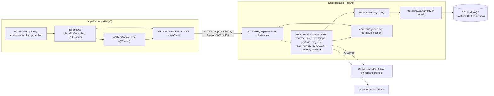

# Architecture Overview

SkillBridge AI is two applications and one shared package in a single repository:

- **`apps/desktop`** — a PyQt6 client. It never touches the database or an AI provider; it talks to the backend over HTTP.
- **`apps/backend`** — a FastAPI service that owns authentication, data, O*NET reference data, AI access, community knowledge, and the training-data pipeline.
- **`packages/onet`** — framework-free parsing and validation for official O*NET archives, used by the backend importer and unit-tested on its own.

## Layers



| Layer | Responsibility | Must not |
| --- | --- | --- |
| UI (`apps/desktop/ui`) | Build widgets, collect input, render results, show dialogs. | Run HTTP requests, build URLs, hold business rules. |
| Controllers (`apps/desktop/controllers`) | Run work on `ApiWorker` threads, track busy state, hold the session token and role. | Touch widgets from worker threads. |
| Desktop services (`apps/desktop/services`) | `BackendService` exposes one typed method per endpoint; `ApiClient` validates the backend URL, adds the `/api/v1` prefix and bearer token, maps errors to readable `ApiError` messages. | Read environment variables (only `config/settings.py` does). |
| API (`apps/backend/api`) | Validate input with Pydantic, resolve the current user, call a service, return JSON. | Contain SQL, prompts, or file handling. |
| Services (`apps/backend/services`) | Business rules, transactions (`commit`), AI prompts, consent and moderation rules. | Know about HTTP. They raise `core.exceptions.AppError` subclasses. |
| Repositories (`apps/backend/repositories`) | Queries and inserts, one module per domain. | Commit or decide policy. |
| Core (`apps/backend/core`) | `Settings` (single source of configuration), JWT and Argon2 helpers, logging setup, error types and HTTP handlers. | — |
| Database (`apps/backend/database`) | Declarative base, engine factory with SQLite foreign keys / PostgreSQL pooling, session dependency, Alembic migrations. | — |

## Request flow

1. A page calls `self.run(lambda: backend.create_roadmap(payload), on_success)`.
2. `TaskRunner` starts an `ApiWorker` thread; the UI shows the busy bar and stays responsive.
3. `BackendService.create_roadmap` → `ApiClient.post("/roadmaps")` → `POST /api/v1/roadmaps` with the bearer token.
4. `routes/roadmaps.create_roadmap` validates `RoadmapRequest`, resolves `CurrentUser`, and calls `services.roadmaps.generation.create_roadmap`.
5. The service calls `services.ai.grounded.generate_grounded`, which retrieves sources (`RetrievalService`), builds the prompt, calls `AIService` (the only place a provider is used), and records `AIUsage`. Provider failures become `ExternalServiceError` → HTTP 503 with a real message, never a fabricated answer.
6. The repository inserts the `Roadmap`; the service commits and returns a dict; the route returns it as JSON.
7. Back on the UI thread, `TaskRunner` calls `on_success(result)`; the page renders the answer and its sources separately.

## AI provider architecture

```
AIService (services/ai/service.py)
├── GeminiProvider      — configured by GEMINI_API_KEY / GEMINI_MODEL, key sent in a header
├── SkillBridgeProvider — placeholder that reports "not trained or deployed"
└── (future providers)  — implement AIProvider.generate / generate_with_image / status
```

`AI_PROVIDER` selects the active provider. No other module imports a provider class; features call `generate_grounded` / `generate_from_image`, so swapping providers never touches feature code.

## Community knowledge and training pipeline

- Students submit contributions (`services/community/contributions.py`). Submissions are **pending** and are never shown as verified.
- Moderators approve or reject. Approval requires copyright confirmation, a de-identification check, a quality rating ≥ 3, and a public copy with no detectable identifiers; the approved copy is stored separately in `approved_knowledge` with a hashed-term embedding for retrieval.
- Training permission is two-level: an account setting (`training_consent`) **and** per-contribution consent. Enabling the setting does not opt in older submissions; disabling it withdraws every permission and revokes drafts that used them.
- `services/training/pipeline.py` builds **dataset drafts** (deterministic split, duplicate removal, identifier redaction). Nothing trains, exports, or deploys a model; `model_versions` only records evaluations an operator enters.

## Error contract

Every error is JSON: `{"detail": <message | validation list>, "error": <category>}` with categories `validation`, `authentication`, `authorization`, `not_found`, `conflict`, `rate_limited`, `ai_provider`, `database`, `server`. `detail` preserves the pre-refactor contract; `error` is additive. Logs record event types and paths, never credentials, tokens, or request bodies.

## Versioning and compatibility

All routes are mounted under `/api/v1` (documented at `/docs`) and again at the historical unprefixed paths (hidden from the schema) so older clients keep working. The desktop targets `/api/v1`.
